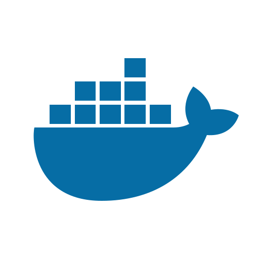
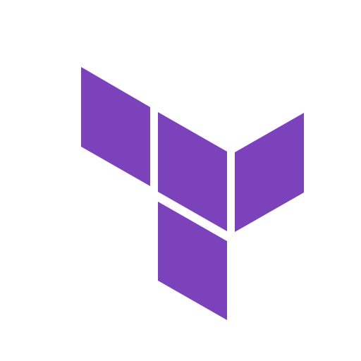
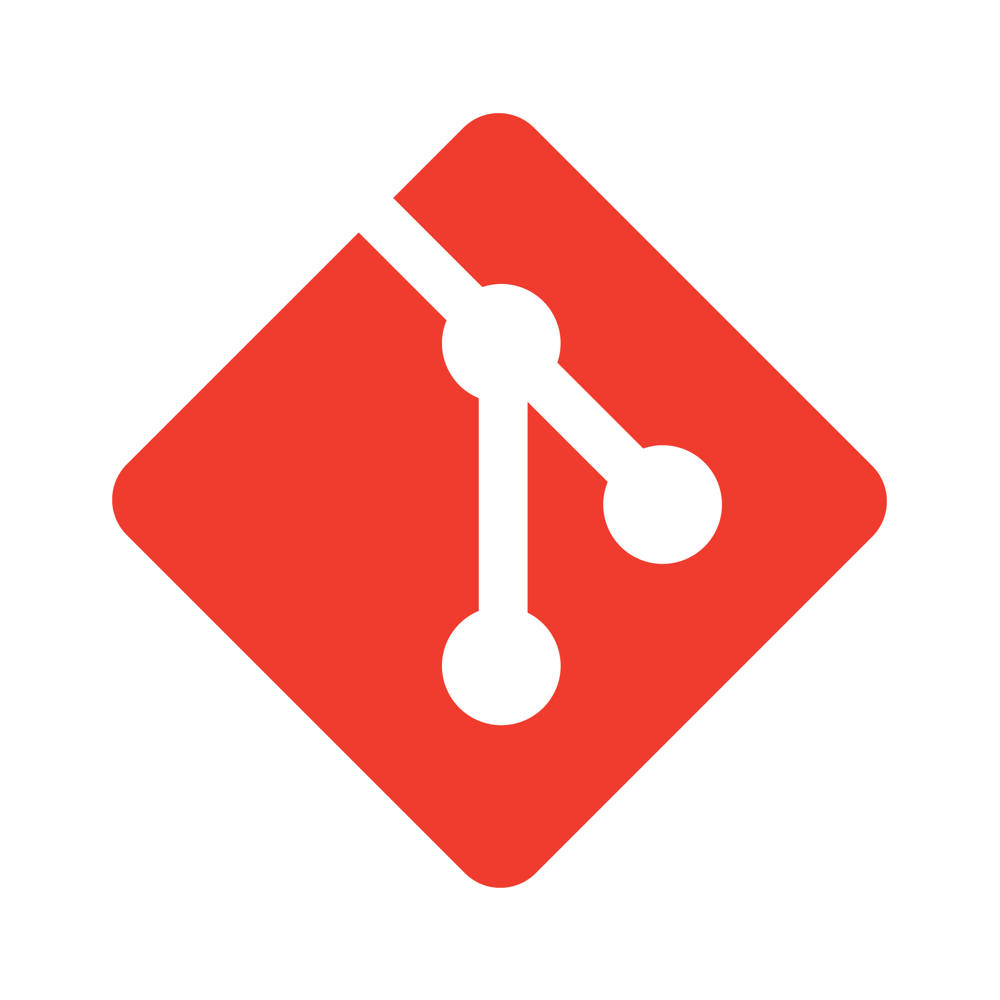
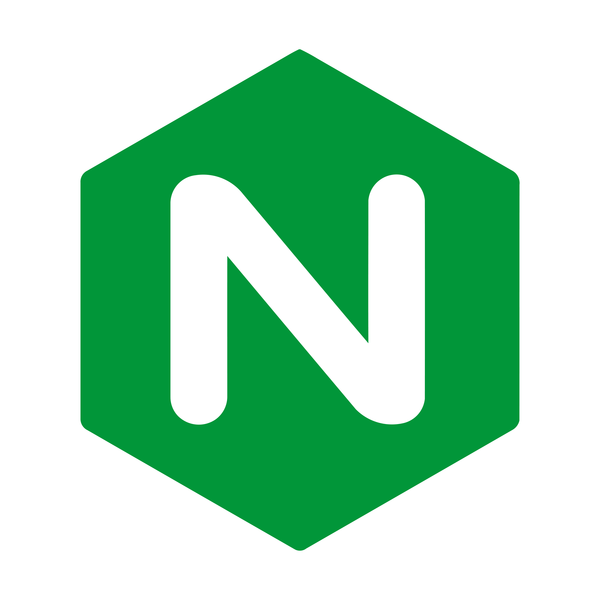

<h1 align="center">Hi, I'm Mehdi 👋</h1>
<h3 align="center">SRE / Platform Engineer — Kubernetes, CNCF, AI agents</h3>

- 🛠️ Working on **platform engineering** and **SRE** problems: Kubernetes, observability, reliability, automation
- 🌱 Diving into **CNCF ecosystem** tooling (ArgoCD, Kyverno, KEDA, cert-manager, Cilium...) and contributing where I can
- 🤖 Exploring **AI agents for infra/ops** — building and experimenting with [kagent](https://github.com/kagent-dev/kagent)
- 🐛 Active user of [sentry-kubernetes](https://github.com/getsentry/sentry-kubernetes) — filing issues, sending PRs when I hit something
- ☁️ AWS Solutions Architect Associate certified
- ✍️ Write-ups on my DevOps/SRE journey: https://mehdibennouar.hashnode.dev/
- 📌 This profile is personal/open-source activity only — my work commits live on a separate account

## Currently building
- **SRE-Platform** — personal platform engineering project
- Various Kubernetes/IaC tooling, kept here as proof-of-work rather than tutorials

## Tech

  
  
  
  
  
  
  
  
  
  

  
  

